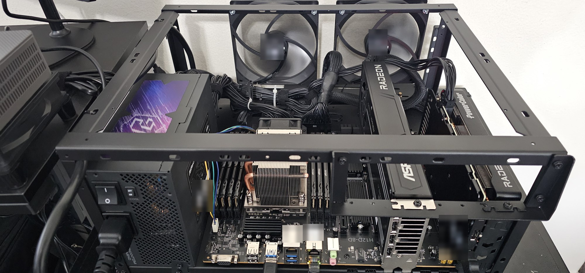

# epyc-amd-llm

Local LLM server on a **Huananzhi H12D-8D** with an **AMD EPYC 7402** and two RDNA 4 Radeons: a
**Radeon AI PRO R9700 32 GB** and an **RX 9060 XT 16 GB**, running llama.cpp on ROCm.
Working configs, measured numbers and the quirks of this board, all from one machine.



## The build

| Part | Model |
|---|---|
| Board | Huananzhi H12D-8D (rev V3.0, BIOS 3.0) |
| CPU | AMD EPYC 7402, 24 cores (SP3) |
| CPU cooler | Dynatron A26 (2U active, heatpipes) |
| RAM | 128 GB: 8 × 16 GB Micron DDR4-2400 RDIMM ECC, all 8 channels |
| GPU 0 | AMD Radeon AI PRO R9700 32 GB, power limit 250 W |
| GPU 1 | AMD Radeon RX 9060 XT 16 GB |
| Storage | Acer Predator GM9 1 TB NVMe (PCIe 5.0 drive, runs at Gen4 here) |
| PSU | ASRock Phantom Gaming PG-1600G, 1600 W, ATX 3.1 |
| Case | open-air stackable test bench |
| Software | Ubuntu 26.04.1, kernel 7.0, llama.cpp ROCm (gfx120X) b1359 |

Both GPUs have a full PCIe 4.0 x16 link to the CPU. Details, PCIe map and quirks: [docs/HARDWARE.md](docs/HARDWARE.md).

## What runs where

- **R9700 (32 GB):** one llama.cpp router on port 9700 with about ten models (27-74B), one loaded at a time,
  swapped on demand by model name.
- **RX 9060 XT (16 GB):** three small always-on servers: a 9B chat model, an embedding model and a reranker.

Scripts, presets and systemd units: [recipes/](recipes/).

## Results

Hard coding set: 7 Python tasks × 3 attempts, 309 hidden checks, run in a sandbox. Everything on the R9700.

| Model | Quant | Checks passed | Fully solved | Gen tok/s |
|---|---|---|---|---|
| Meta Muse-Glimmer 30B | UD-Q4_K_XL | 302/309 (97.7%) | 19/21 | 31.7 (62 with DFlash) |
| Recursive Flint 40B-A2.5B | UD-Q4_K_XL | 299/309 (96.8%) | 19/21 | 73.7 |
| Qwen3.6 27B | UD-Q4_K_XL | 278/309 (90.0%) | 14/21 | 27.8 |
| Nemotron 3.5 Bolt 74B-A9B "24GB" + DFlash | NVIDIA 2-bit | 259/309 (83.8%) | 19/21 | 100.2 |
| Qwen3.8 27B | UD-Q4_K_XL | 256/309 (82.8%) | 15/21 | 27.9 |
| Nemotron 3.5 Lightning 30B-A3B | UD-Q4_K_XL | 178/309 (57.6%) | 5/21 | 107.2 |

Also measured:

- **DFlash speculative decoding** doubles Glimmer's speed: 31 → 60 tok/s, same score.
- **R9700 at 250 W instead of 300 W:** −3.5% prompt speed, −1% generation, 6 °C cooler.
- **120B MoE models** run with experts in system RAM at 6-13 tok/s.

Full tables, method and caveats: **[BENCHMARKS.md](BENCHMARKS.md)**.

## Repository

| Path | What |
|---|---|
| [`BENCHMARKS.md`](BENCHMARKS.md) | every measured result |
| [`docs/HARDWARE.md`](docs/HARDWARE.md) | parts, PCIe layout, memory, power, quirks |
| [`recipes/`](recipes/) | llama.cpp router presets, start scripts, systemd units, R9700 power cap |
| [`bench/code_test.py`](bench/code_test.py) | the coding benchmark (Python stdlib only) |
| [`scripts/report.sh`](scripts/report.sh) | prints a rig report for an AMD GPU machine |

## Run the benchmark on your machine

```bash
python3 bench/code_test.py --validate                     # check the tests themselves
python3 bench/code_test.py --url http://localhost:8080 --key-file ~/key.txt \
        --models <your-model> --set hard --repeat 3 --thinking --max-tokens 32000
bash scripts/report.sh > my-rig.md                         # hardware and software summary
```

The benchmark runs each answer with no network through `unshare -rn`. If every check fails with
`unshare: write failed /proc/self/uid_map: Operation not permitted`, your system (or the container or tool
you run it from) blocks unprivileged user namespaces; on Ubuntu see `kernel.apparmor_restrict_unprivileged_userns`.

## License

[MIT](LICENSE). Model files are not included; each model has its own license.
