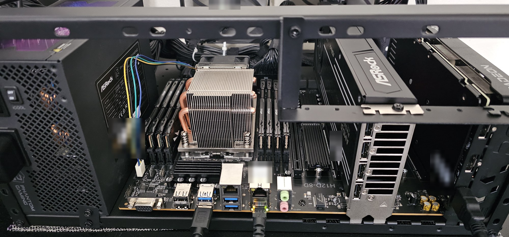

# Hardware notes

What it took to run two RDNA 4 Radeons on a Huananzhi H12D-8D, and what to expect.



## Parts

| Part | Model | Notes |
|---|---|---|
| Board | Huananzhi H12D-8D | revision V3.0, AMI BIOS 3.0 (2026-09-16); single SP3 socket, 8 DIMM slots, onboard ASPEED VGA |
| CPU | AMD EPYC 7402 | 24 cores / 48 threads, Zen 2 (Rome), 180 W, 128 PCIe 4.0 lanes, one NUMA node |
| CPU cooler | Dynatron A26 | 2U active heatsink with heatpipes, SP3 |
| RAM | 8 × 16 GB Micron 36ASF2G72PZ-2G1A2 | DDR4 registered ECC, dual-rank, running 2400 MT/s, all 8 channels |
| GPU 0 | AMD Radeon AI PRO R9700 32 GB (ASRock) | RDNA 4 (gfx1201), blower; power limit set to 250 W (range 210-300 W) |
| GPU 1 | AMD Radeon RX 9060 XT 16 GB (PowerColor) | RDNA 4 (gfx1200); stock 160 W limit (max 182 W) |
| Storage | Acer Predator GM9 1 TB | PCIe 5.0 NVMe, runs at PCIe 4.0 x4 on this board |
| PSU | ASRock Phantom Gaming PG-1600G | 1600 W, ATX 3.1, 80 Plus Gold / Cybenetics Platinum, fully modular, 12V-2x6 |
| Case | open-air stackable test bench | ATX / E-ATX, two large fans mounted on the frame |

## PCIe layout

Both GPUs get a full **PCIe 4.0 x16** link straight to a CPU root port. There is no PCIe switch on the board.

| GPU | PCI address | CPU root port | Link to CPU | HIP index |
|---|---|---|---|---|
| R9700 | `0000:03:00.0` | `00:01.1` | 16 GT/s x16 (PCIe 4.0) | **1** |
| RX 9060 XT | `0000:43:00.0` | `40:03.1` | 16 GT/s x16 (PCIe 4.0) | **0** |

- `lspci` and sysfs report **32 GT/s** (PCIe 5.0) on the GPU itself. Each card has its own small PCIe switch
  inside (an upstream and a downstream port); 32 GT/s is the link inside the card, and the card's upstream
  port runs at 16 GT/s to the CPU. Walk up the tree to the root port to see the real link:
  ```bash
  p=$(readlink -f /sys/bus/pci/devices/0000:03:00.0)
  while [ -e "$p/current_link_speed" ]; do echo "$(basename $p) $(cat $p/current_link_speed) x$(cat $p/current_link_width)"; p=$(dirname $p); done
  ```
- **The HIP order is the reverse of the PCI order.** ROCm numbers the 9060 XT as device 0 and the R9700 as 1.
  Pick cards with `HIP_VISIBLE_DEVICES`, and check with a short load which card's VRAM goes up before you
  trust an index. `rocm-smi`/`amd-smi` may number them differently again.
- The NVMe drive is PCIe 5.0 but the EPYC 7002 platform is PCIe 4.0, so it runs at Gen4 x4 (about 7 GB/s).
  That only affects how fast models load.

## Memory bandwidth

8 channels × 2400 MT/s × 8 bytes ≈ **154 GB/s** in theory. The EPYC 7402 supports DDR4-3200 (≈205 GB/s), so
faster DIMMs would help, but only for models that spill out of VRAM: with expert weights in RAM
(`n-cpu-moe`), a 120B MoE ran at 6-13 tok/s here, against 20-110 tok/s for models that fit on the R9700.
Fill all 8 slots: every empty channel cuts bandwidth by an eighth.

## Power and cooling

- Load: R9700 at most 250 W (capped), 9060 XT at most 160 W, CPU 180 W TDP. The whole system stays well under
  1 kW, so the 1600 W PSU has plenty of headroom (sized for a second large GPU).
- The R9700's limit resets to 300 W at every boot and GPU reset; a oneshot systemd unit sets it again
  ([`recipes/power-cap/`](../recipes/power-cap/)). Measured cost of 250 W: about 3.5% prompt speed and 1%
  generation speed ([BENCHMARKS.md](../BENCHMARKS.md#r9700-power-limit)).
- On an open bench there is no case airflow: the Dynatron A26's own fan cools the CPU, and the two frame
  fans are the only other airflow.
- Peak R9700 junction temperature: 91 °C at 300 W, 85 °C at 250 W (prompt-heavy load).

## Software

| | Version |
|---|---|
| OS | Ubuntu 26.04.1 LTS |
| Kernel | 7.0.0 (in-tree `amdgpu`) |
| ROCm (system, for `amd-smi`) | 10.1.0 |
| llama.cpp | ROCm builds b1350, then b1359, from [lemonade-sdk/llamacpp-rocm](https://github.com/lemonade-sdk/llamacpp-rocm) (`gfx120X`); they bundle their own ROCm libraries |

## Quirks seen

- **RX 9060 XT power-management firmware (SMU) hang at boot.** Once in 31 boots the card's SMU hung
  about 10 s into boot (`amdgpu 0000:43:00.0: SMU is in hanged state, failed to send smu message!` in the
  kernel log). Every sensor read then fails and the card is unusable until a reboot; a reboot fixed it.
  If a service on that card fails at boot, check `journalctl -k | grep -i smu` first.
- **The 9060 XT's fans stop at idle** (zero-RPM mode), so it idles a few degrees warmer than the R9700,
  whose blower never stops. Not a fault.
- **llama.cpp b1350 can't load Recursive Flint** (unknown architecture); b1359 can.
- **Router mode:** never send a request that names a model (`/slots?model=X`, chat requests) just to check
  on it: the router loads that model. Read a loaded model's state from its own child process port instead.

## BIOS

BIOS 3.0 (2026-09-16). The state below was read from Linux (`/sys`, the kernel log and `lspci -vvv`), not
from the setup screens, so it shows what is in effect rather than which options were changed.

| Setting | State | How to check |
|---|---|---|
| Boot mode | UEFI; Secure Boot disabled | `ls /sys/firmware/efi`, `mokutil --sb-state` |
| Above 4G decoding + Resizable BAR | on: BAR 0 spans all VRAM (32 GB on the R9700, 16 GB on the 9060 XT) | `sudo lspci -vvv -s 03:00.0 \| grep -A2 "Resizable BAR"` |
| IOMMU | on (AMD-Vi); ACS enabled on the GPU root ports | `ls /sys/class/iommu` |
| PCIe link speed | Gen4 (16 GT/s) x16 to both GPUs | see [PCIe layout](#pcie-layout) |
| PCIe ASPM (link power saving) | disabled on the GPU links | `sudo lspci -vvv \| grep "LnkCtl:"` |
| SMT | on, 48 threads | `cat /sys/devices/system/cpu/smt/control` |
| NUMA nodes per socket | NPS1 (one node) | `ls -d /sys/devices/system/node/node*` |
| Core performance boost | on | `cat /sys/devices/system/cpu/cpufreq/boost` |
| Global C-states | on (C1, C2) | `cat /sys/devices/system/cpu/cpu0/cpuidle/state*/name` |
| Memory | 2400 MT/s, 8 channels | `sudo dmidecode -t memory` |

**For GPUs on this board, make sure Above 4G decoding and Re-Size BAR support are enabled**: they let the
system map each card's whole VRAM. [`scripts/report.sh`](../scripts/report.sh) prints most of this table.
